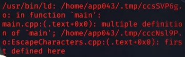

/error/image.png
There is a error 

the code is 
```
#include<iostream>
using namespace std;
int main(){
cout<<"Hello";
}
```

# Fix
```
#include<iostream>
using namespace std;
int main(){
cout<<"Hello";
}
```

## Because the error is 
so this error happens when there are two files running ```.exe```